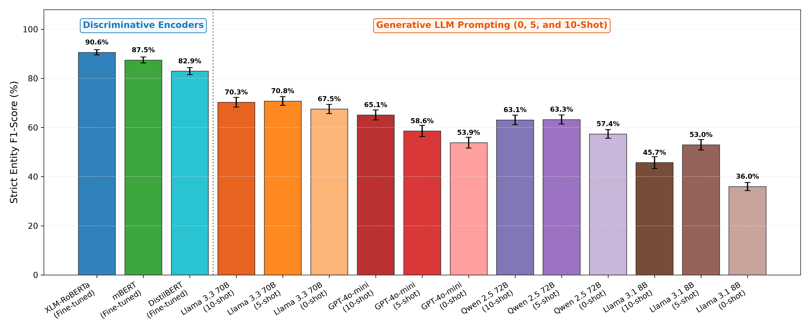
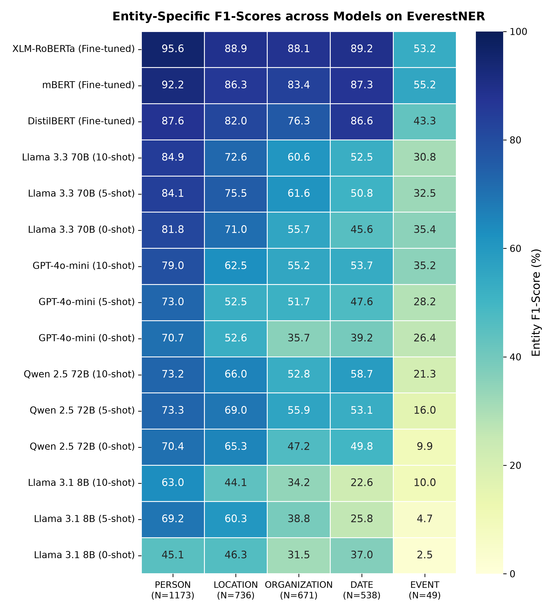

# Research-nner: Nepali Named Entity Recognition (EverestNER)

A research project for **Named Entity Recognition (NER) in the Nepali language** using the **EverestNER** dataset. Compares two approaches:

1. **Fine-tuned Encoder Models** — BERT-based token classification (traditional NER pipeline)
2. **LLM API-based Evaluation** — Few-shot / zero-shot NER via GPT-4, Claude, Gemini, Groq-hosted LLaMA & Mixtral, and Mistral APIs

Also supports **QLoRA fine-tuning** of generative LLMs (Llama, Mistral, Gemma, Phi) for the NER task.

---

## Project Structure

```
├── scripts/                          # CLI entry points
│   ├── train_baseline.py             # Train a single baseline encoder model
│   ├── train_models_sequentially.py  # Sequential training of multiple baseline models
│   ├── train_qlora_ner.py            # QLoRA fine-tuning of generative LLMs
│   ├── evaluate_trained_models.py    # Re-evaluate already-trained baseline models
│   ├── evaluate_llm_apis.py          # Evaluate LLM APIs (GPT-4, Claude, Gemini, Groq, Mistral)
│   ├── test_model.py                 # Interactive test with sample Nepali sentences
│   ├── split_dataset.py              # Split a single BIO file into train/val/test
│   └── convert_data.py               # Convert CoNLL / JSON data to formatted outputs
├── src/                              # Core library
│   ├── __init__.py                   # Package init (exports BIOConverter)
│   ├── baseline_trainer.py           # NERTrainer class for encoder-based NER training
│   ├── converter.py                  # BIOConverter (BIO → formatted text)
│   └── convert_bio_to_instruction.py # BioToInstructionConverter (BIO → LLM instruction format)
├── results/                          # Evaluation outputs (comparison tables, API logs)
├── models/                           # (gitignored) Trained model weights
├── data/                             # (gitignored) Dataset files
├── requirements.txt                  # Python dependencies
└── .gitignore
```

---

## Dataset

The project is designed for the **EverestNER** Nepali NER dataset. Expected file patterns in `data/raw/`:

- `EverestNER-train-bio.txt` (or `EverestNER-train-bio`, `train.bio`, `train.txt`)
- `EverestNER-val-bio.txt` (optional — falls back to 90/10 split from training data)
- `EverestNER-test-bio.txt`

**Format:** Standard CoNLL / BIO format — one token per line with whitespace-separated token and BIO tag, blank lines separate sentences.

```
राम      B-PER
काठमाडौं  B-LOC
मा       O
बस्छन्   O
।        O
```

Entity types are auto-detected from the training file (e.g., `PER`, `LOC`, `ORG`, `DATE`, `EVENT`).

<p align="center">
  
</p>

---

## Baseline Encoder Models

Three multilingual transformer models fine-tuned as token classifiers:

| Key | Model | Parameters | Batch Size | Epochs |
|-----|-------|-----------|------------|--------|
| `mbert` | `bert-base-multilingual-cased` | ~110M | 64 | 10 |
| `xlm-roberta` | `xlm-roberta-base` | ~279M | 64 | 10 |
| `distilbert` | `distilbert-base-multilingual-cased` | ~67M | 64 | 10 |

**Training features:**
- Auto-detected label mappings from BIO tag set
- Word-to-token alignment (`-100` for subword tokens)
- HuggingFace `Trainer` with `DataCollatorForTokenClassification`
- Hyperparameters: Learning rate `2e-5`, batch size `64`, `10` epochs, `500` linear warmup steps
- `EarlyStoppingCallback` (patience=3)
- Seqeval-based evaluation with **bootstrapped 95% confidence intervals** (500 iterations)
- FP16 training when CUDA is available
- Gradient accumulation (×2)

---

## QLoRA Fine-Tuning

Generative decoder-only models fine-tuned with 4-bit QLoRA for instruction-following NER:

| Key | Model | Parameters | Context | Requires HF Token |
|-----|-------|-----------|---------|-------------------|
| `phi` | `microsoft/phi-2` | 2.7B | 2048 | No |
| `gemma` | `google/gemma-2b-it` | 2B | 8192 | Yes |
| `llama` | `meta-llama/Llama-3.2-3B-Instruct` | 3B | 8192 | Yes |
| `mistral` | `mistralai/Mistral-7B-Instruct-v0.3` | 7B | 8192 | No |

**Training features:**
- 4-bit quantization (`nf4`, double quant) via `BitsAndBytesConfig`
- LoRA (`r=16`, `alpha=32`) on `q_proj`, `k_proj`, `v_proj`, `o_proj`
- Instruction-response format: "Extract all named entities from the following Nepali text..."
- Memory limit: 6GB GPU / 6GB CPU
- Paged AdamW 8-bit optimizer

<p align="center">
  
</p>

---

## LLM API Evaluation

Evaluates frontier LLMs via OpenRouter and direct APIs on the EverestNER held-out test set ($N = 2{,}078$). Compares using **seqeval** strict entity-level matching (same metric as baseline encoder models) across **0-shot, 5-shot, and 10-shot** configurations.

| Model | OpenRouter Endpoint | 0-Shot F1 (%) | 5-Shot F1 (%) | 10-Shot F1 (%) |
|-------|---------------------|:-------------:|:-------------:|:--------------:|
| **Llama 3.3 70B Instruct** | `meta-llama/llama-3.3-70b-instruct` | 67.53 ± 1.88 | **70.78 ± 1.77** | 70.27 ± 1.94 |
| **GPT-4o-mini** | `openai/gpt-4o-mini` | 53.85 ± 2.20 | 58.58 ± 2.27 | **65.12 ± 2.03** |
| **Qwen 2.5 72B Instruct** | `qwen/qwen-2.5-72b-instruct` | 57.38 ± 1.76 | **63.26 ± 1.86** | 63.10 ± 1.92 |
| **Llama 3.1 8B Instruct** | `meta-llama/llama-3.1-8b-instruct` | 35.98 ± 1.66 | **52.97 ± 2.14** | 45.72 ± 2.38 |

**Features:**
- 0-shot, 5-shot, and 10-shot in-context prompting with automatic checkpointing & resume
- Deterministic greedy longest-match entity-level BIO alignment from JSON responses
- Per-sample audit logs (JSONL) with tokens, predictions, raw output, latency, token counts, and 95% bootstrap confidence intervals
- Paired sentence-level bootstrap significance testing (`scripts/compute_paired_significance.py`)

---

## Usage

### Setup

```bash
pip install -r requirements.txt
pip install peft bitsandbytes anthropic groq mistralai  # Additional dependencies
```
├── assets/                           # Publication figures (barchart, heatmap, scatter)

Place your EverestNER dataset files in `data/raw/`.

### Training Baseline Encoder Models

```bash
# Train a single model (default: bert-base-multilingual-cased)
python scripts/train_baseline.py

# Sequential training with progress tracking
python scripts/train_models_sequentially.py
python scripts/train_models_sequentially.py --model mbert
python scripts/train_models_sequentially.py --status
python scripts/train_models_sequentially.py --reset
```

### QLoRA Fine-Tuning

```bash
# List available models
python scripts/train_qlora_ner.py --list-models

# Train a specific model
python scripts/train_qlora_ner.py --model phi --epochs 3 --batch-size 2
python scripts/train_qlora_ner.py --model llama --token YOUR_HF_TOKEN
```

### Evaluate LLM APIs

```bash
python scripts/evaluate_llm_apis.py \
    --model groq-llama \
    --api-key YOUR_KEY \
    --shots 5 \
    --max-samples 100

python scripts/evaluate_llm_apis.py \
    --model gpt4 \
    --api-key YOUR_KEY \
    --shots 0 \
    --max-samples 50
```

### Evaluate Trained Models

```bash
python scripts/evaluate_trained_models.py
```

### Interactive Testing

```bash
python scripts/test_model.py
```

### Data Utilities

```bash
# Split a single BIO file into train/val/test (70/15/15)
python scripts/split_dataset.py

# Convert CoNLL/JSON data to formatted outputs
python scripts/convert_data.py
```

---

## What We Used

### Software & Frameworks

| Component | Version | Purpose |
|-----------|---------|---------|
| Python | 3.10+ | Runtime |
| PyTorch | 2.9.1 | Deep learning engine |
| HuggingFace Transformers | 4.57.3 | Model loading, tokenization, Trainer API |
| HuggingFace Datasets | 4.4.1 | Dataset handling |
| HuggingFace Evaluate | 0.4.6 | Seqeval metric wrapper |
| PEFT | 0.14+ | LoRA / QLoRA configuration |
| bitsandbytes | 0.45+ | 4-bit quantization |
| seqeval | 1.2.2 | NER evaluation (precision, recall, F1) |
| Accelerate | 1.12.0 | Distributed / mixed-precision training |
| scikit-learn | 1.7.2 | Data utilities |
| pandas | 2.3.3 | Result manipulation |
| safetensors | 0.7.0 | Safe model serialization |
| sentencepiece | 0.2.1 | XLM-R tokenizer support |

### API Clients (LLM Evaluation)

| Library | Models Accessed |
|---------|----------------|
| `openai` | GPT-4 Turbo Preview |
| `anthropic` | Claude 3.5 Sonnet |
| `google-generativeai` | Gemini 2.0 Flash |
| `groq` | LLaMA 3.3 70B, Mixtral 8x7B |
| `mistralai` | Mistral Large |

### Models

| Category | Models |
|----------|--------|
| **Encoder (baseline)** | `bert-base-multilingual-cased`, `xlm-roberta-base`, `distilbert-base-multilingual-cased` |
| **Generative (QLoRA)** | `microsoft/phi-2`, `google/gemma-2b-it`, `meta-llama/Llama-3.2-3B-Instruct`, `mistralai/Mistral-7B-Instruct-v0.3` |
| **API (zero/few-shot)** | GPT-4 Turbo, Claude 3.5 Sonnet, Gemini 2.0 Flash, LLaMA 3.3 70B, Mixtral 8x7B, Mistral Large |

### Dataset

- **EverestNER** — Nepali NER dataset in standard CoNLL BIO format
- Entity types: `PER`, `LOC`, `ORG`, `DATE`, `EVENT` (auto-detected from training data)

### Hardware

| Resource | Details |
|----------|---------|
| GPU (encoder training) | CUDA-compatible GPU with ≥8GB VRAM (FP16 recommended) |
| GPU (QLoRA) | CUDA GPU with ≥6GB VRAM (4-bit quantized) |
| CPU | Any x86-64 with ≥8GB RAM |
| Storage | ~5GB for models + data |

---

## How to Reproduce

### 1. Environment Setup

```bash
git clone <repo-url> Research-nner
cd Research-nner

# Create virtual environment
python -m venv venv
# Windows
venv\Scripts\activate
# Linux/macOS
# source venv/bin/activate

# Install core dependencies
pip install -r requirements.txt

# Install additional dependencies
pip install peft bitsandbytes anthropic groq mistralai
```

### 2. Prepare the Dataset

Place the EverestNER dataset in `data/raw/`. The expected file is a single CoNLL BIO file. If you only have one file, split it:

```bash
# Split a single BIO file into train/val/test (70/15/15)
python scripts/split_dataset.py
```

This creates:
- `data/raw/EverestNER-train-bio.txt`
- `data/raw/EverestNER-val-bio.txt`
- `data/raw/EverestNER-test-bio.txt`

### 3. Train Baseline Encoder Models

**Option A — Train a single model:**
```bash
python scripts/train_baseline.py
```
Defaults to `bert-base-multilingual-cased`. Saves to `models/baseline/bert-base-multilingual-cased/`.

**Option B — Train all models with progress tracking:**
```bash
# Show status and select interactively
python scripts/train_models_sequentially.py

# Train a specific model non-interactively
python scripts/train_models_sequentially.py --model mbert
python scripts/train_models_sequentially.py --model xlm-roberta
python scripts/train_models_sequentially.py --model distilbert

# Check training progress
python scripts/train_models_sequentially.py --status

# Reset all progress (start fresh)
python scripts/train_models_sequentially.py --reset
```

Results are saved to:
- `models/baseline/{model_key}/final_model/` — model weights and tokenizer
- `models/baseline/{model_key}/test_results.json` — evaluation metrics with 95% CI
- `models/baseline/comparison_results.json` — aggregated comparison

### 4. Evaluate Baselines (Post-Training)

Re-evaluate any trained models on the test set:

```bash
python scripts/evaluate_trained_models.py
```

### 5. (Optional) QLoRA Fine-Tuning

```bash
# List available generative models
python scripts/train_qlora_ner.py --list-models

# Train Phi-2 (no token required)
python scripts/train_qlora_ner.py --model phi --epochs 3 --batch-size 2

# Train Llama 3.2 3B (requires HuggingFace token)
python scripts/train_qlora_ner.py --model llama --token hf_YOUR_TOKEN --epochs 3

# Train Mistral 7B
python scripts/train_qlora_ner.py --model mistral --epochs 2 --batch-size 1
```

Models are saved to `models/qlora/{model_key}/final_model/`.

### 6. Evaluate LLM APIs

```bash
# GPT-4 — 0-shot, 50 samples
python scripts/evaluate_llm_apis.py \
    --model gpt4 \
    --api-key sk-YOUR_KEY \
    --shots 0 \
    --max-samples 50

# Groq LLaMA — 5-shot, full test set
python scripts/evaluate_llm_apis.py \
    --model groq-llama \
    --api-key gsk_YOUR_KEY \
    --shots 5 \
    --max-samples 100

# Gemini — 0-shot
python scripts/evaluate_llm_apis.py \
    --model gemini \
    --api-key AIzaYOUR_KEY \
    --shots 0 \
    --max-samples 50

# Claude 3.5 Sonnet
python scripts/evaluate_llm_apis.py \
    --model claude \
    --api-key sk-ant-YOUR_KEY \
    --shots 3 \
    --max-samples 50

# Mistral Large
python scripts/evaluate_llm_apis.py \
    --model mistral \
    --api-key YOUR_KEY \
    --shots 0 \
    --max-samples 50
```

Audit logs are saved to `results/llm_api/{model}_shots{n}_n{m}_seed{s}.jsonl`.

### 7. Interactive Testing

Test a trained encoder model on sample Nepali sentences:

```bash
python scripts/test_model.py
```

### 8. Data Conversion (Optional)

Convert BIO-format data to formatted text or LLM instruction format:

```bash
# Convert CoNLL/JSON → formatted text with entity markers
python scripts/convert_data.py

# Convert BIO → instruction format (for QLoRA or LLM training)
python src/convert_bio_to_instruction.py
```

### 9. Collect Results

All evaluation outputs are in `results/`:
- `results/comparison/comparison_data.json` — unified JSON across all models
- `results/comparison/comparison_table.md` — Markdown comparison table
- `results/comparison/comparison_table.csv` — CSV comparison table
- `results/comparison/comparison_table.tex` — LaTeX comparison table
- `results/llm_api/*.jsonl` — per-sample API evaluation audit logs

### Reproducibility Notes

- All random seeds are set to `42` (`--seed 42`)
- Encoder training uses early stopping (patience=3) on validation F1
- Hyperparameters: AdamW optimizer, `lr=2e-5`, `epochs=10`, `batch_size=64`, `warmup_steps=500`
- Bootstrapped 95% confidence intervals use 500 iterations with replacement
- LLM API evaluation uses deterministic sampling (temperature=0 where supported)
- Few-shot examples are drawn from the **training set** only (never from test)

---

## Results

Evaluation outputs are stored in `results/`:
- **`results/comparison/`** — Comparison tables (JSON, Markdown, CSV, LaTeX) across all models
- **`results/llm_api/`** — Per-model API evaluation audit logs (JSONL)

Metrics computed: Precision, Recall, F1 Score, Accuracy (token-level and entity-level via seqeval). Encoder models additionally report bootstrapped 95% confidence intervals.

---

## Comparison Dimensions

| Dimension | Fine-tuned Encoders | LLM APIs | QLoRA Models |
|-----------|-------------------|----------|--------------|
| Accuracy | High | Moderate | Moderate-High |
| Training Required | Yes | No (few-shot) | Yes |
| Inference Speed | Fast | Slow (API latency) | Moderate |
| Cost | GPU compute | API usage fees | GPU compute |
| Setup Complexity | Moderate | Low (API key only) | High |
